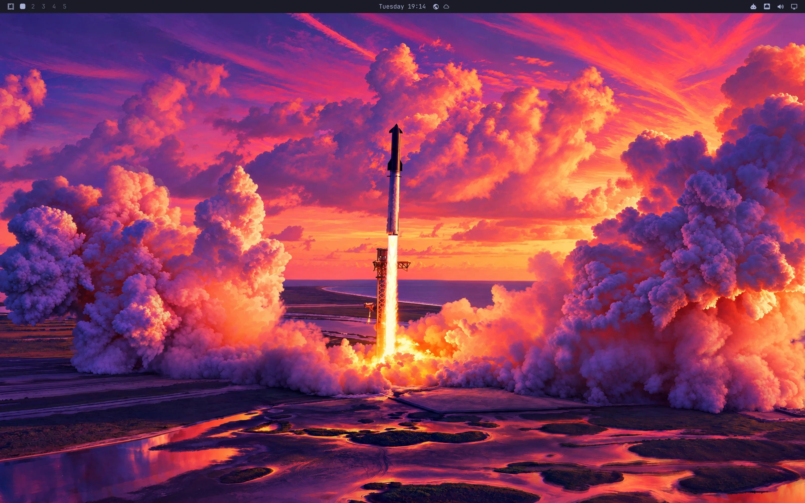

Omarchy 4.5 aka Quattro RS is out! We skipped straight from 4.0 to 4.5 because this one is a massive leap, tuned from the kernel up. It's the first feature release since [Quattro](https://github.com/omacom/omarchy/releases/tag/v4.0.0) in August: 370 pull requests from 76 people (plus Omabot, who never sleeps). Here are the highlights.

**Our own kernel.** Quattro RS runs on the Omarchy kernel: Linux 7.2 with the BORE scheduler, which favors the apps you're actually using over whatever is grinding away in the background. It runs at 1000 Hz, fully preemptible, with a stack of scheduler and memory fixes Krzysztof has been tuning since [he joined](/news/2026/09/omacom-foundation-hires-krzysztof-wilczynski/), and on x86 it's compiled at -O3. ARM runs it too, BORE and all. (If you're on 4.0.6, you got it a little early.)

**Omarchy now speaks 50 languages.** Pick one under *Setup > Language* (or run `omarchy language ja`), and the menu, the desktop, and Omarchy's own notifications switch right away. No logout needed, and apps you open afterward follow along wherever they have the translation. That's Arabic, Bulgarian, Czech, German, Hebrew, Indonesian, Persian, Swahili, Ukrainian, Traditional Chinese, and forty more. We launched [omarchy.org in 29 languages](/news/2026/09/omarchy-org-redesign-launches-with-29-languages/) just six weeks ago, and now the OS itself has overtaken the website! The installer sets up Japanese, Chinese, and Korean input too.

**ARM laptops are here.** Omarchy grew up on x86, but this is the release where ARM gets real. NVIDIA's new RTX Spark laptops, the ASUS ProArt P14 and the Dell XPS 16 Creator Edition, run Omarchy with NVIDIA's open driver on release firmware. Ryan had that support merged the day before they started shipping! Snapdragon X laptops like the Lenovo Yoga Slim 7x and the ThinkPad T14s run it too, thanks to [Omarchy Dragon](/news/2026/09/introducing-omarchy-dragon/). On the Yoga, the camera works in Chromium, and hardware video decoding takes 1080p playback from 50–60% of a core down to about 20%.

And for the first time, a release comes with an ARM ISO to install all of it from. Emir has it building, installing, and booting every night on [Namespace](/news/2026/10/namespace-joins-as-a-distinguished-corporate-patron/)'s Apple Silicon runners, so ARM gets tested like x86. Meanwhile, [Omarchy M](/news/2026/09/introducing-omarchy-m/) took a big step toward the Mac: the shared hardware and desktop support from Omarchy Mac now lives in Omarchy itself, with the Mac-specific drivers and boot setup in the Omarchy Mac packages. Let's finish what Asahi started!

**Liftoff.** A fresh Quattro RS boots to a Starship lifting off at sunset. That's Tom Ballard's Liftoff, now the first wallpaper in Tokyo Night. And there's a whole new Starship theme for anyone who wants the full launch sequence. What else would you expect from a distro backed by [the folks catching boosters with chopsticks](/news/2026/10/spacexai-joins-as-founding-corporate-patron/)?

**Every monitor gets its own workspaces.** `Super + 1` now takes you to the first workspace on the monitor you're using, not wherever workspace 1 happened to end up. Each bar shows only its own monitor's workspaces, and a monitor gets the same ones back every time you plug it in.

**Notifications got smarter.** They stack by sender, and you can snooze them, turn on Do Not Disturb, and scroll back through your history. Verification codes, links, and action buttons work right from the card. This started as [Neil Jagdish Patel](https://github.com/njpatel)'s Omapager plugin, and Ryan has now built it into Omarchy proper. That's the plugin ecosystem working exactly as intended!

**Floating workspaces with a dock.** `Super + L` cycles a workspace between tiling, scrolling, and floating. Go floating, and every window gets a titlebar in your theme's colors, plus a dock with your pinned apps, everything running, and a grid of every app. `Super + M` minimizes to it. If you're coming from a Mac, this one's for you. (And if you're a tiling purist, you never have to see it!)

**Moving pictures and a world clock.** Backgrounds can be videos now, on the desktop and the lock screen, and themes can play a short, silent intro when you log in or switch to them (Yam's handiwork). Utterly unnecessary. Completely delightful. It's all under the new *Appearance* menu. There's also Elsewhen, a world clock right next to the regular one: add the cities and the people who live there, so you know whether it's a decent hour to ping them. And `Super + Grave` drops a Quake-style console over the desktop, the perfect home for your coding agent. Thanks, Tobi!

**Faster, everywhere.** I spent a good chunk of this cycle hunting milliseconds:

- Booting from firmware to the login screen went from 17.8 seconds to 10.8 in our install test. Limine now waits one second at its menu instead of several, quietly (press any key if you need it), and registering binary formats no longer holds up startup for almost a second.
- `Super + Space` opens the Omarchy menu in 31ms instead of 94ms.
- The menu's checks of your hardware and network take 52ms instead of 380ms.
- Logging out, rebooting, and shutting down happen the moment your apps have closed.

Fast computers should feel fast!

**More for the agents, and tighter security.** You can switch between several Claude and Codex subscriptions, pick Kimi or Ori as your default coding agent, and dictate with Superwhisper out of the box on new installs. A solid round of hardening went in too, from keeping the Windows VM password out of process arguments to moving screen-recording state out of world-writable `/tmp`. And if you find something we missed, there's now [real money in it](/news/2026/10/omarchy-launches-bug-bounty-program-on-hackerone/).

Existing installations can upgrade with *Update > Omarchy*. For new machines, grab the [x86 ISO](https://iso.omarchy.org/omarchy-4.5.0.iso) or, for the first time, the [ARM ISO](https://iso.omarchy.org/omarchy-4.5.0-aarch64.iso). As always, back up anything important first! The [release notes](https://github.com/omacom/omarchy/releases/tag/v4.5.0) have the rest of what's new.

Thank you to everyone who sent in code, to [Omarchy Core](/teams/), M, Dragon, and the Rangers, and to Ryan for getting this release out the door. And to [our patrons](/patrons/): DigitalOcean runs our package builds, Namespace boots our ARM ISO every night, Cloudflare delivers every ISO and package, and Greptile reviews the flood of pull requests. We're grateful for their patronage.

Two months after Quattro, and the RS is ready to race. We can fix everything!
