Omarchy 4.5 (aka Quattro RS!) is the first big feature release since [Quattro](https://github.com/omacom/omarchy/releases/tag/v4.0.0), and it's a whopper: over 740 pull requests merged from more than 180 contributors in just twelve weeks. It now offers a traditional desktop mode next to the tiling default. You can install it natively on a M1/M2/M3/Neo MacBooks. And it speaks 50 languages. And a gazillion other features, fixes, and improvements. Already on Omarchy? Run _Update > Omarchy_. New machine? [Grab it here](/#install).

## Floating workspaces with a dock

`Super + L` now cycles any workspace between tiling, scrolling, and floating. On a floating workspace, every window gets a titlebar in your theme's colors, and a dock shows your pinned apps, everything that's running, and a grid of every app installed. Drag to reorder or pin, right-click for more, and `Super + M` minimizes a window down to the dock.

<video src="omarchy-4-5-floating.mp4" autoplay muted loop playsinline aria-label="Floating workspace with the dock"></video>

This is a wonderful on-ramp for anyone arriving from macOS or Windows who isn't ready to go all-in on tiling yet. Or for anyone who just wants one workspace where windows can sprawl. Mix and match per workspace, and the bar shows which layout each one uses.

## Omarchy on Apple Silicon

Our incredible [Omarchy M](/news/2026/09/introducing-omarchy-m/) team has shipped the native Mac installer. Download an app on macOS, and it'll put Omarchy right alongside it on your M1, M2, M3, or Neo MacBook. No USB stick, no terminal incantations.

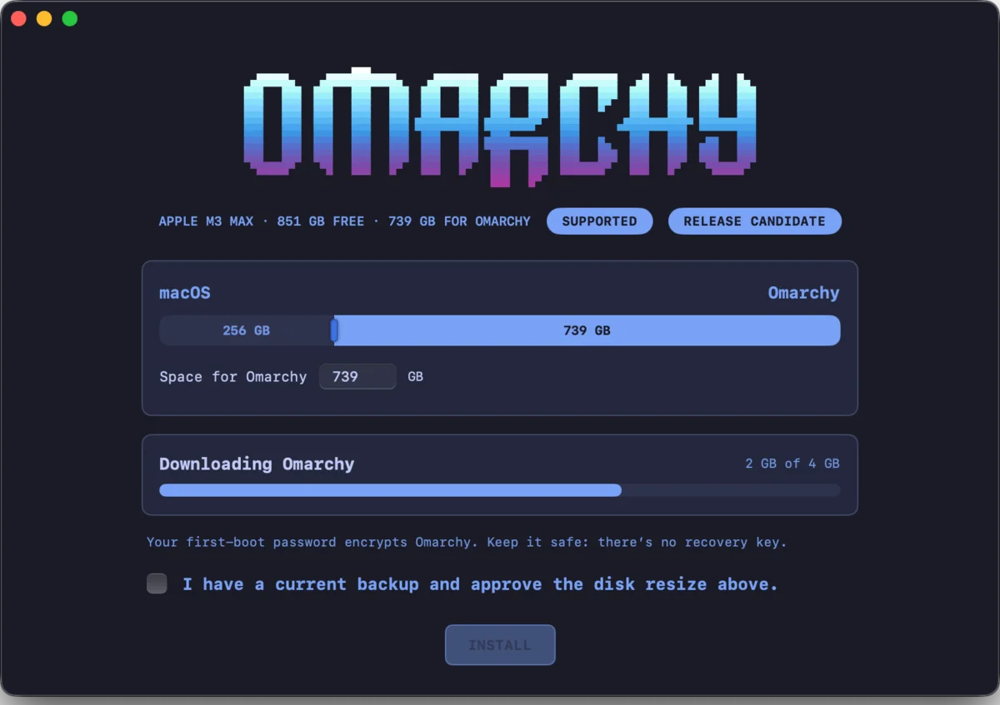

This is what we set out to do in September: finish what Asahi started. Two months later, you can just download it. Amazing work by everyone on the team.

And they're not stopping there. M4, M5, and M6 are all being worked on right now, so it probably won't be long until Omarchy runs on every Apple Silicon Mac.

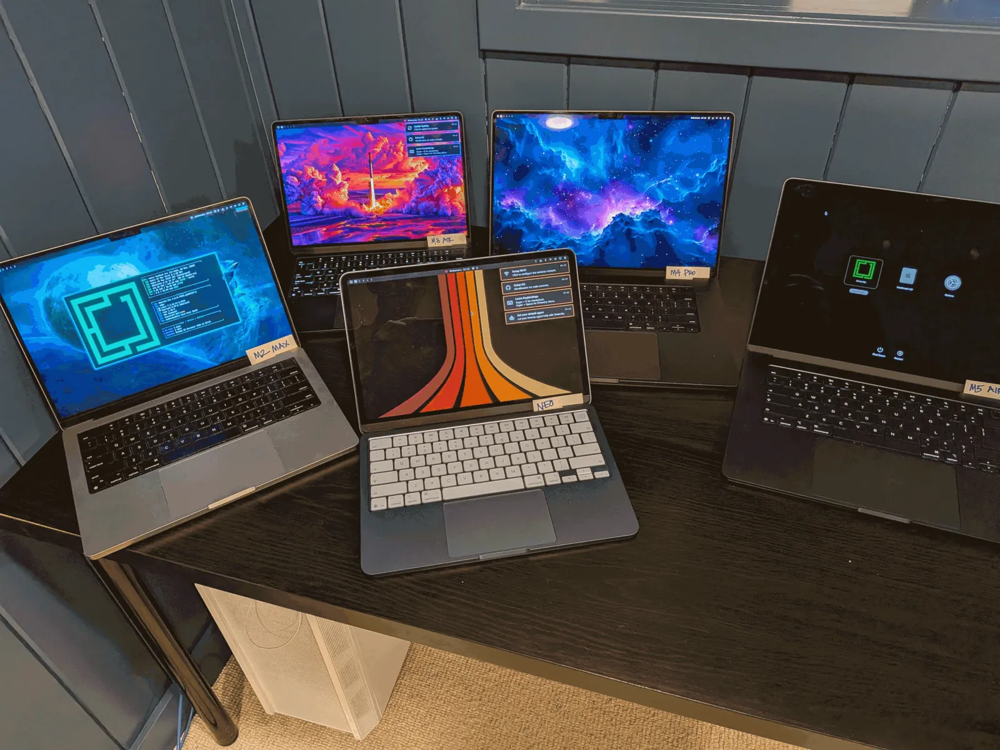

## ARM support for NVIDIA DGX Spark + N1X (and soon Snapdragon)

Omarchy 4.5 ships its first ARM ISO, and with it comes preliminary support for NVIDIA's ARM machines: the DGX Spark desktop and the laptops built on the N1X, like the [Dell XPS 16 Creator Edition](https://www.dell.com/en-us/shop/laptop-computers/spd/xps16dx16263) and the [ASUS ProArt P14](https://eshop.asus.com/us/31148-us-cnf-auto.html). And soon we'll have support for the entire lineup of Snapdragon ARM machines as well. It's still early days, so expect a few rough edges, and please report anything that breaks on [GitHub](https://github.com/omacom/omarchy/issues).

## 50 languages and 5 input methods

Omarchy now speaks 50 languages. Pick one under _Setup > Language_ (or run `omarchy language <code>`), and the menu, the desktop, and Omarchy's notifications switch immediately. The system locale follows on your next login.

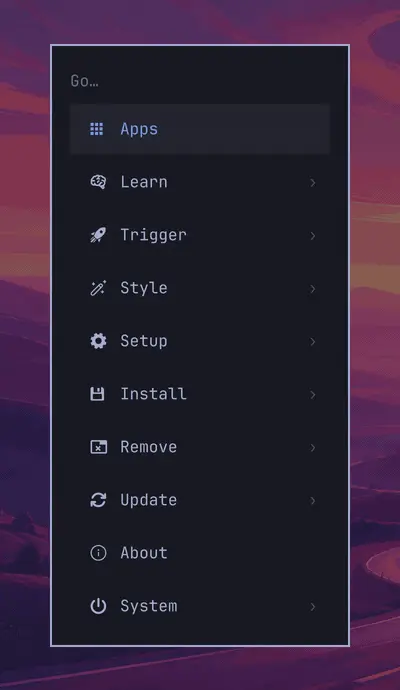

Speaking a language is only half of it, though. You also need to type it. So Omarchy now sets up proper input methods for Japanese (Mozc), Korean (Hangul), Simplified Chinese (Pinyin), Taiwan (Zhuyin), and Hong Kong (Cangjie), right from the installer or later under _Setup > Keyboard_. Each one comes with the right fonts for its character forms, the candidate window follows your theme, and `Super + I` switches between your input languages. Hangul, Zhuyin, and Cangjie keep their keys in the standard positions even if you type Latin on Dvorak, Colemak, or AZERTY, just like on Windows and macOS. And tapping Shift on its own steps out of an input method into Latin letters and back again, the way Sogou, Microsoft Pinyin, and macOS work.

## Sign in to captive Wi-Fi portals

Hotel, airport, and coffee shop Wi-Fi finally just works. Omarchy now notices when a network wants you to sign in or accept its terms before letting you online. The network icon warns you, and the network panel shows a big Open Captive Portal button that takes you straight to the login page. Once you're through, everything goes back to normal on its own.

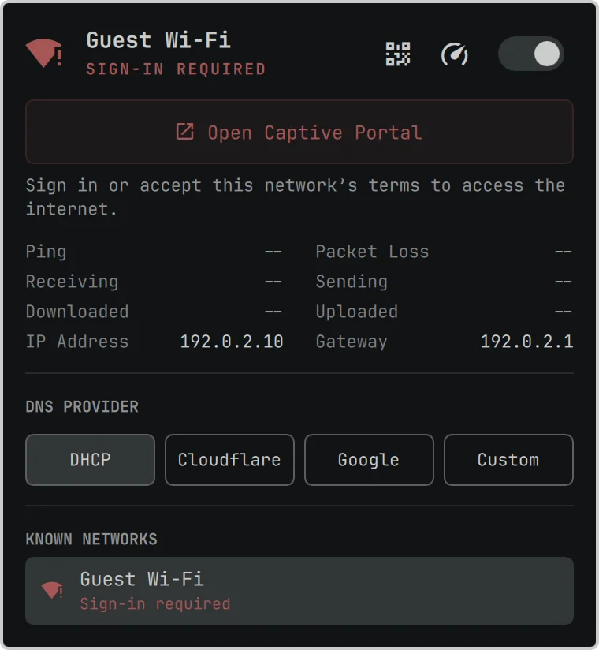{: width="380"}

## Five new default apps

**Hype** makes presentations from a single Markdown file, with a visual slide editor beside the source, and exports to PDF or PowerPoint.

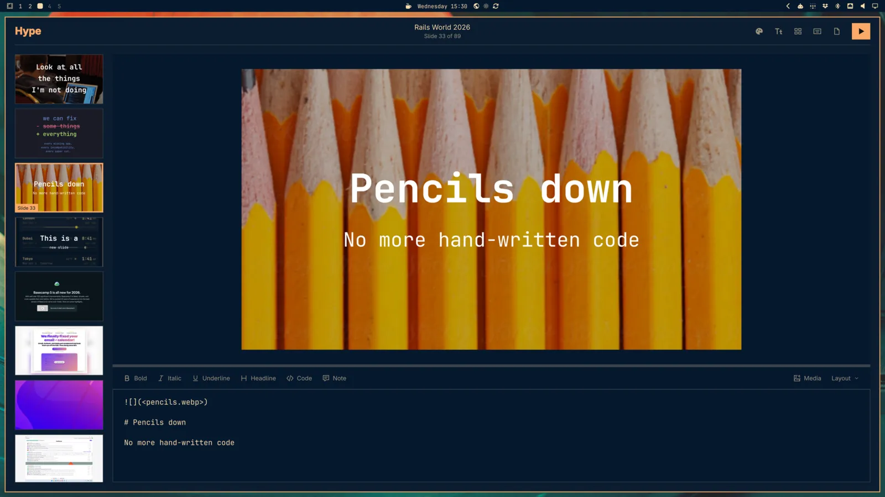

**Signed** replaces Xournal++ for the paperwork: open a PDF, place your saved signature, text, and dates, and save a signed copy.

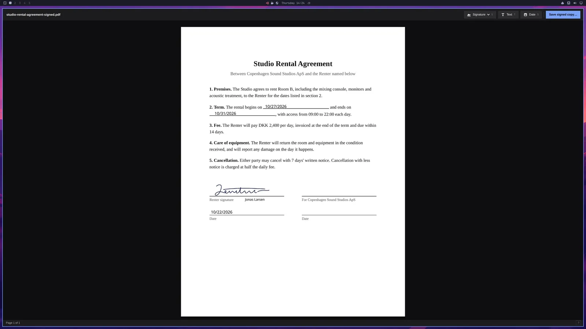

**Disktree** draws a treemap of what's filling your disk, colored by kind, calls out the caches that are safe to regenerate, and lets you mark what should go.

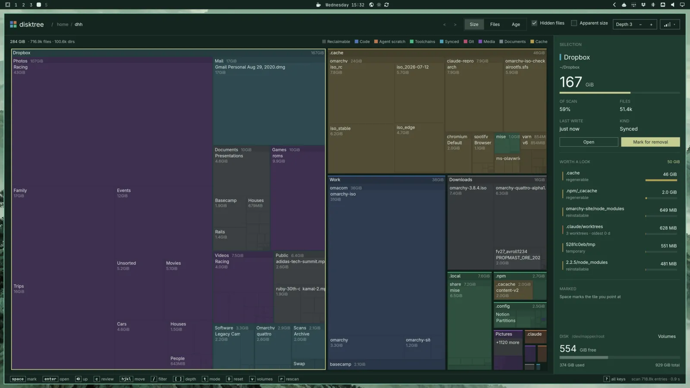

**Monologue** records your camera with one key, themed to match your desktop.

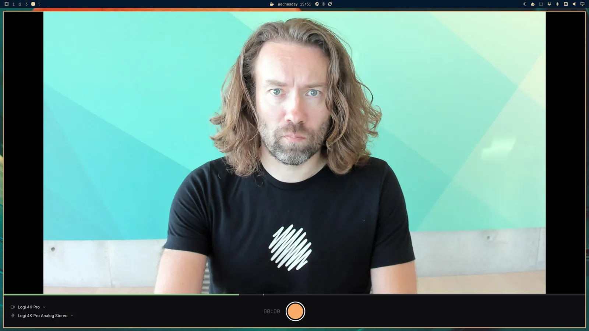

**Gliff** gives you a remote desktop over SSH. Connect to another Omarchy machine and drive its full desktop from a window on yours, with a tab for each machine. And because it rides on SSH, there's nothing extra to set up or expose. The machine being controlled shows a remote session indicator in the bar, so it's always clear when someone is on it.

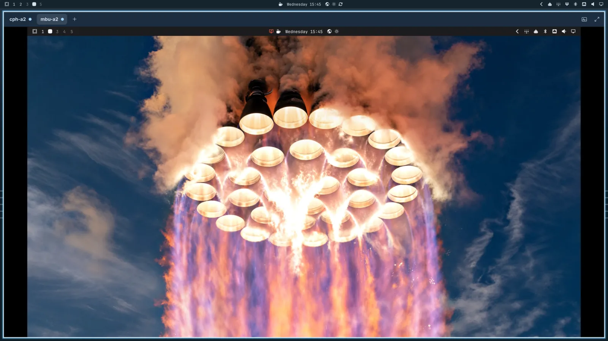

And there's **Elsewhen**, a world clock that lives right next to the clock in the bar. Tap a city on the globe to set where you are, search for real places, and name the people who live in each city, so you always know whether it's a decent hour to call. Flip between 12 and 24 hours with `t`, between °F and °C with `Alt + T`, and summon it anytime with `Super + Ctrl + Alt + E`.

With Monologue for recording and Omacut for trimming, new installs no longer ship OBS Studio and Kdenlive. Lazydocker is gone from new installs too, though Docker and Docker Compose are still included. Machines that already have any of them keep them.

## Microsoft 365

Need to work with people who live in Office? _Install > Service > Microsoft_ now sets up Outlook, Word, Excel, PowerPoint, Teams, and OneDrive as web apps. Each one gets its own window and launcher entry, so they feel right at home next to everything else. No more excuses for not switching to Omarchy at work!

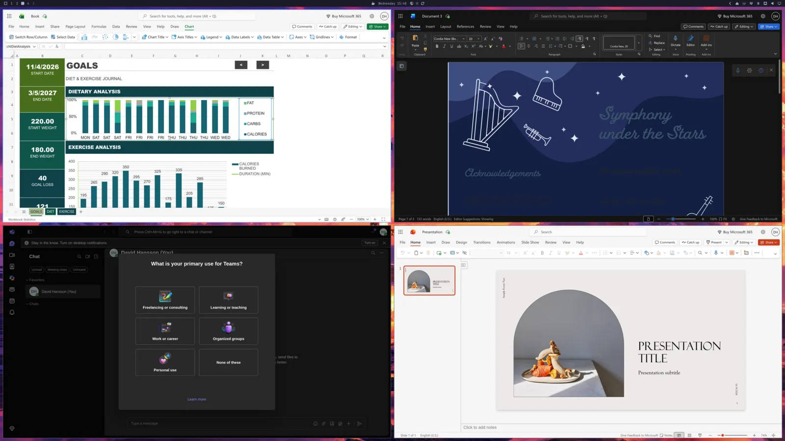

## Superwhisper for dictation

Superwhisper is now Omarchy's default dictation engine, and it's set up out of the box. Tap `Alt + Space` to start talking and again to stop, or hold `Right Alt` for push-to-talk. It's incredibly fast and very accurate.

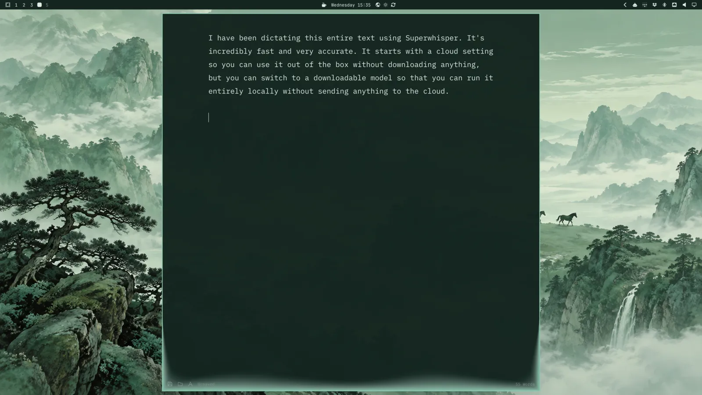

It starts in the cloud, so it works the moment you install, and the first 10,000 words are free. But you can switch to a downloadable model that's entirely free and runs completely locally, without sending a word to anyone. And if you'd rather go with another local model, Voxtype is still on offer as an alternative.

## Install in less than ten seconds

Omarchy used to install some 940 packages one by one. The new F1 installer instead unpacks a prebuilt root image and adds just this machine's packages on top. That cuts install times roughly in half on any machine.

And on fast hardware, it's absurd. [Anush Elangovan](https://x.com/AnushElangovan) from AMD set the world record with a full Omarchy install in **7 seconds** on his AMD laptop. [Seven seconds!](https://x.com/dhh/status/2117222836620202375) I remember when five minutes seemed like an ambitious goal.

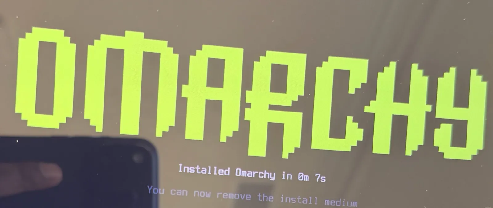

## Faster everywhere else

It's not just the installer. Startup no longer stalls on binfmt registration. The theme picker opens right away instead of after a quarter of a second. Menus and panels open straight from Hyprland shortcuts, skipping the 60 ms it took to start a process first. The Omarchy menu's slowest checks went from 200 ms to 16 ms, a new terminal shows its prompt 30 ms sooner, and the whole desktop now reacts to changes instead of polling for them. Even logging out, rebooting, and shutting down happen the moment your apps finish closing.

## Agent upgrades

Omarchy is the agentic OS, and 4.5 brings a big round of upgrades for working with agents. The agents panel now tracks 23 agents and providers, up from 6, including Cursor, OpenCode, GitHub Copilot, Antigravity, Hermes, Amp, Kiro, Devin, Qwen, DeepSeek, OpenRouter, and Ollama. Every limit gets its own meter with the time until it resets, so you can see exactly how much runway you have left. And Grok is now a full provider alongside Claude and Codex.

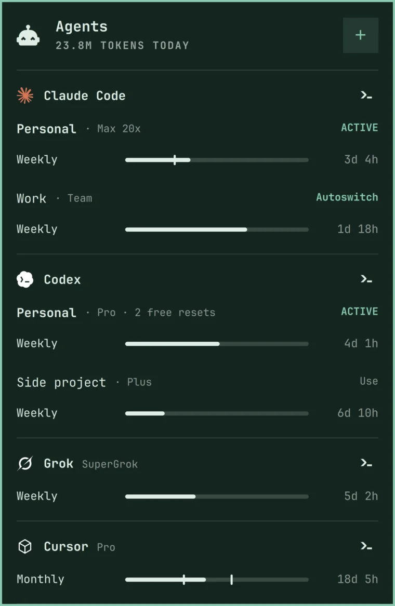{: width="380"}

And your agent is always one keystroke away. `Super + ~` drops down a Quake-style console over a dimmed desktop, and the first time you open it, it starts your default agent. Press it again to tuck it away, and your session is right where you left it.

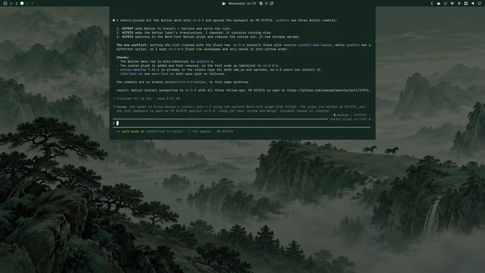

If you juggle more than one subscription, you can now keep several Claude, Codex, and Grok logins on the same machine and pick which one new sessions start with, using `omarchy agent account`. History, settings, and skills are shared between them, so `claude --continue` picks up right where you left off after a switch. Near a limit, Omarchy can either offer a one-click switch or move new sessions over to the account with the most headroom on its own. And when you set up another machine, `omarchy agent account copy` brings all your logins over SSH, so you don't have to sign in to everything again.

Kimi and Ori, OpenRouter's agent harness, join the choices under _Setup > Defaults > Agent_, and Google's Antigravity replaces the obsolete Gemini CLI (`gemini` still works as an alias). Prefer a window to a terminal? The Claude and Amp desktop apps are now a click away under _Install > AI_.

## Notifications, rebuilt

Notifications now stack by sender, follow your theme, and collapse identical repeats. Action buttons, verification codes, and links all work right from the card. `Super + Comma` acts on the newest one (dismiss, open, or press its button), and `Super + Ctrl + Comma` hands you the keyboard to drive them all. The bell in the bar turns on Do Not Disturb.

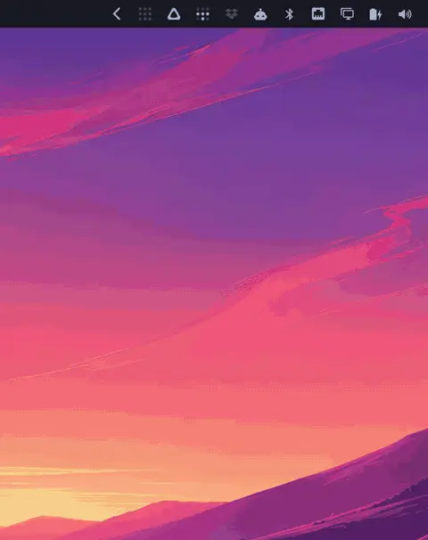

## Video backgrounds and theme intros

Backgrounds can now be videos. Drop one in, and your desktop comes alive with rolling waves or whatever else you fancy, while the lock screen shows a still frame from it. And themes now make an entrance: each one can play a short, silent intro when you log in or switch to it. (Rather keep it calm? Turn intros off under _Appearance > Animations_.)

<video src="omarchy-4-5-live-intros.mp4" autoplay muted loop playsinline aria-label="Theme intros and video backgrounds"></video>

## Jade Horse joins the default themes

Jade Horse is all misty greens, with carved-jade backgrounds that make the whole desktop look like a scroll painting. It replaces Osaka Jade among the bundled themes, and it's joined by Starship as the other new default theme. If you're on Osaka Jade, you keep your copy, and it lives on as a [third-party theme](https://github.com/omacom/omarchy-osaka-jade-theme) for anyone who wants to install it fresh.

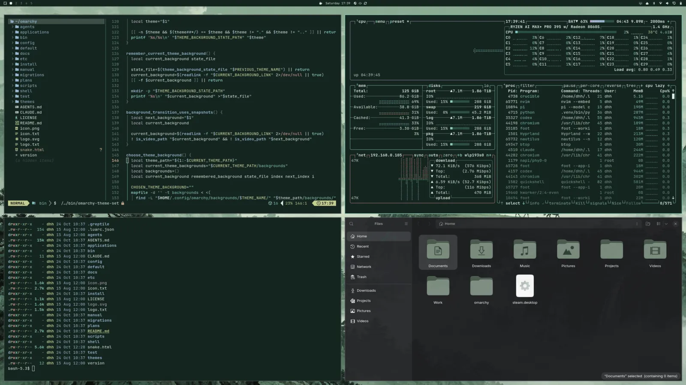

## Liftoff is the new default background

New installs now greet you with Liftoff, a gorgeous sunset launch that's the new default background for Tokyo Night. It was made by [Tom Ballard](https://github.com/tcballard), who first created it for his [Liftoff theme](https://github.com/tcballard/omarchy-theme-liftoff). Thanks, Tom!

## Boot menu now quiet

Omarchy used to show the boot menu for about six seconds on every start, just in case you needed to roll back to an earlier snapshot. But almost nobody ever did. So now Limine waits just one second and boots quietly, and most of the time you won't see the menu at all.

When you do need a different entry or a snapshot, keep tapping any key (the down arrow works) while the machine starts, and it'll stop at the menu. And if you'd rather keep the menu up longer for good, set your own `timeout:` in `/boot/limine.conf` (like `timeout: 5`). Updates will leave a timeout you set alone.

## Changed hotkeys

Some shortcuts moved:

- Calculator: `Super + Ctrl + Q` is now `Super + Shift + Q`.
- Activity: `Super + Ctrl + T` is now `Super + Shift + T`, and `Super + Ctrl + T` opens themes.
- Network: `Super + Ctrl + W` is now `Super + Ctrl + N`, and `Super + Ctrl + W` opens backgrounds.
- Nightlight no longer has a shortcut (it was `Super + Ctrl + N`); it's in `Trigger > Toggle`.
- `Super + Alt + Space` opens Apps from the dock instead of the Apps menu.

Notification shortcuts changed:

- `Super + Comma` acts on the newest card (dismisses it, opens it, or presses its one button) instead of only dismissing it.
- Dismissing the last one moved to `Super + Alt + Comma`, which used to open it.
- Silencing moved from `Super + Ctrl + Comma` to `Super + Ctrl + Alt + Comma`; `Super + Ctrl + Comma` now hands you keyboard control.

A few keys work differently:

- `Super + Tab`, `Super + Shift + Tab`, `Super + Ctrl + Tab`, and `Super` + scroll stay on the current monitor's workspaces, since every monitor has its own.
- In a terminal, `Super + C` and `Super + V` send `Ctrl + Shift + C` and `Ctrl + Shift + V` instead of `Ctrl + Insert` and `Shift + Insert`.

New defaults that could collide with bindings of your own: `Super + Q` (close window, alongside `Super + W`), `Super + A` (select all), `Super + M` (minimize to the dock), `Super + ~` and `Super + Shift + ~` (Quake console), `Super + Alt + L` (previous layout), `Super + Shift + Ctrl + Arrows` (move a window to another monitor), `Super + Ctrl + Alt + C` (screenshot), `Super + Ctrl + Alt + E` (world clock), `Super + Ctrl + Alt + F` (full screen desktop), and holding `Right Alt` for push-to-talk dictation.

## More features

- Give every monitor its own workspaces: `Super + 1-0` goes to the workspaces of the monitor you're on, and `Super + Arrows` moves to and from the other displays by [@ryanrhughes](https://github.com/ryanrhughes) in [#15655](https://github.com/omacom/omarchy/pull/15655)
- Gather everything about how the desktop looks into a new Appearance menu, replacing Style: theme, background, font, bar, windows, branding, the dock, workspace layouts, animations, and the unlock screen by [@dhh](https://github.com/dhh) in [#15973](https://github.com/omacom/omarchy/pull/15973)
- Pick Opaque, Transparent, or Glassy windows under _Appearance > Window Transparency_, plus a Glassy bar background by [@dhh](https://github.com/dhh) in [#14991](https://github.com/omacom/omarchy/pull/14991)
- Pick theme, sharp, or rounded window corners under _Appearance > Window Corners_ by [@dhh](https://github.com/dhh) in [#14990](https://github.com/omacom/omarchy/pull/14990)
- Add a no-animations mode, on by default in VMs by [@dhh](https://github.com/dhh) in [#13550](https://github.com/omacom/omarchy/pull/13550)
- Make apps opaque by default, keeping terminals transparent by [@dhh](https://github.com/dhh) in [#14253](https://github.com/omacom/omarchy/pull/14253)
- Add Slack to Install > Service by [@dhh](https://github.com/dhh) in [#14434](https://github.com/omacom/omarchy/pull/14434)
- Make Alt + Space toggle dictation on every backend by [@dhh](https://github.com/dhh) in [#17188](https://github.com/omacom/omarchy/pull/17188)
- Add Open and Edit buttons to screenshot notifications, and Open and Cut to screen recordings and yt-dlp downloads by [@dhh](https://github.com/dhh) in [#16505](https://github.com/omacom/omarchy/pull/16505)
- Add an Update > Kernel menu for switching the default kernel by [@dhh](https://github.com/dhh) in [#15966](https://github.com/omacom/omarchy/pull/15966)
- Add theme sync to herdr machines by [@dhh](https://github.com/dhh) in [#13430](https://github.com/omacom/omarchy/pull/13430)
- Add o.rebind for replacing Hyprland keybindings by [@ryanrhughes](https://github.com/ryanrhughes) in [#10537](https://github.com/omacom/omarchy/pull/10537)
- Ask for your git identity after first login instead of in the installer, with GitHub sign-in by [@omarchybot](https://github.com/omarchybot) in [#16288](https://github.com/omacom/omarchy/pull/16288)
- Allow install media to preset the language, keyboard, and timezone by [@omarchybot](https://github.com/omarchybot) in [#15522](https://github.com/omacom/omarchy/pull/15522)
- Allow bar widgets to live in the tray's drawer by [@dhh](https://github.com/dhh) in [#15281](https://github.com/omacom/omarchy/pull/15281)
- Allow removing a bar widget by dragging it off the bar by [@ryanrhughes](https://github.com/ryanrhughes) in [#6782](https://github.com/omacom/omarchy/pull/6782)
- Allow scrolling through workspaces from the bar by [@outfoxxed](https://github.com/outfoxxed) in [#15256](https://github.com/omacom/omarchy/pull/15256)
- Allow deleting extra themes from the theme picker by [@dhh](https://github.com/dhh) in [#14713](https://github.com/omacom/omarchy/pull/14713)
- Add hey, basecamp, and Cloudflare CLIs as lazy-installed tools by [@monorkin](https://github.com/monorkin) in [#7626](https://github.com/omacom/omarchy/pull/7626)
- Add SSH Agent as an optional service by [@carletex](https://github.com/carletex) in [#9399](https://github.com/omacom/omarchy/pull/9399)
- Allow choosing how long passwordless sudo lasts by [@dhh](https://github.com/dhh) in [#14435](https://github.com/omacom/omarchy/pull/14435)
- Add a hover close button to notification toasts by [@dhh](https://github.com/dhh) in [#6946](https://github.com/omacom/omarchy/pull/6946)
- Allow muting a program's notifications from its crash diagnosis by [@omarchybot](https://github.com/omarchybot) in [#8549](https://github.com/omacom/omarchy/pull/8549)
- Allow omarchy-notification-send to add action buttons by [@dhh](https://github.com/dhh) in [#16466](https://github.com/omacom/omarchy/pull/16466)
- Add a clock format with live seconds by [@omarchybot](https://github.com/omarchybot) in [#7586](https://github.com/omacom/omarchy/pull/7586)
- Adjust the keyboard backlight with Ctrl and the brightness keys by [@ludagoo](https://github.com/ludagoo) in [#16650](https://github.com/omacom/omarchy/pull/16650)
- Print the OEM Windows product key from firmware by [@dhh](https://github.com/dhh) in [#7480](https://github.com/omacom/omarchy/pull/7480)
- Add original vi as a terminal editor choice by [@dhh](https://github.com/dhh) in [#10307](https://github.com/omacom/omarchy/pull/10307)
- Add the Roadster Starlight background to Ethereal by [@bjarneo](https://github.com/bjarneo), [@tcballard](https://github.com/tcballard) in [#15878](https://github.com/omacom/omarchy/pull/15878)

## Security

- Keep the Windows VM password out of the RDP client's arguments by [@dicemans](https://github.com/dicemans) in [#7902](https://github.com/omacom/omarchy/pull/7902)
- Move screen-recording state out of world-writable /tmp by [@Chessing234](https://github.com/Chessing234) in [#8374](https://github.com/omacom/omarchy/pull/8374)
- Harden passwordless sudo expiry across suspend by [@AFOliveira](https://github.com/AFOliveira) in [#9457](https://github.com/omacom/omarchy/pull/9457)
- Bind update inhibitor cleanup to the process that created it by [@AFOliveira](https://github.com/AFOliveira) in [#9467](https://github.com/omacom/omarchy/pull/9467)
- Isolate OCaml cleanup authorization by [@ErikMelton](https://github.com/ErikMelton) in [#10217](https://github.com/omacom/omarchy/pull/10217)
- Pin factory-reset elevation to the packaged command by [@AFOliveira](https://github.com/AFOliveira) in [#13047](https://github.com/omacom/omarchy/pull/13047)
- Remove saved fingerprint templates for the invoking user on reset by [@AFOliveira](https://github.com/AFOliveira) in [#13049](https://github.com/omacom/omarchy/pull/13049)
- Refuse hook and state names that are paths by [@Adolanium](https://github.com/Adolanium) in [#8170](https://github.com/omacom/omarchy/pull/8170)
- Defer to system-auth in the polkit stack written by fingerprint and FIDO2 setup by [@Wheel-Smith](https://github.com/Wheel-Smith) in [#9873](https://github.com/omacom/omarchy/pull/9873)
- Remove fingerprints from the reader's own storage when removing them by [@scottjones](https://github.com/scottjones) in [#16403](https://github.com/omacom/omarchy/pull/16403)
- Prevent SSH setup from leaving sshd running with password logins when no key gets added by [@omarchybot](https://github.com/omarchybot), [@thebytorsnowdog](https://github.com/thebytorsnowdog) in [#14667](https://github.com/omacom/omarchy/pull/14667)
- Prevent another local user from swapping in their own program during a Voxtype upgrade by [@Vladkarok](https://github.com/Vladkarok) in [omacom/omarchy-pkgs#937](https://github.com/omacom/omarchy-pkgs/pull/937)
- Harden how factory reset passes your gum settings through sudo by [@AFOliveira](https://github.com/AFOliveira) in [#13316](https://github.com/omacom/omarchy/pull/13316)

## Fixes

- Fix Hyprland crashing when a monitor is unplugged, disabled, or turned off by closing the lid by [@falkoro](https://github.com/falkoro) in [#16750](https://github.com/omacom/omarchy/pull/16750)
- Fix upgrades that could leave a kernel image without its root= parameter by [@dhh](https://github.com/dhh) in [#6951](https://github.com/omacom/omarchy/pull/6951)
- Fix factory reset erasing other systems' boot entries by [@omarchybot](https://github.com/omarchybot) in [#14949](https://github.com/omacom/omarchy/pull/14949)
- Fix an install next to another Omarchy removing that install's boot entry by [@emirb](https://github.com/emirb) in [omacom/omarchy-iso@716bc15](https://github.com/omacom/omarchy-iso/commit/716bc15)
- Fix free-space installs that could take an existing partition for a new one by [@emirb](https://github.com/emirb) in [omacom/omarchy-iso#307](https://github.com/omacom/omarchy-iso/pull/307)
- Fix resuming an interrupted drive password change removing the wrong key by [@scottjones](https://github.com/scottjones) in [#14874](https://github.com/omacom/omarchy/pull/14874)
- Ask for the sudo password once per Omarchy update by [@dhh](https://github.com/dhh) in [#13323](https://github.com/omacom/omarchy/pull/13323)
- Ask for the sudo password once for ten minutes instead of again on every command by [@dhh](https://github.com/dhh) in [#17000](https://github.com/omacom/omarchy/pull/17000)
- Cover AUR updates and the boot check with the update's single sudo prompt by [@omarchybot](https://github.com/omarchybot) in [#16568](https://github.com/omacom/omarchy/pull/16568)
- Keep package updates safe from logging out mid-transaction by [@dhh](https://github.com/dhh) in [#11651](https://github.com/omacom/omarchy/pull/11651)
- Log out, reboot, and shut down as soon as apps finish closing by [@dhh](https://github.com/dhh) in [#15231](https://github.com/omacom/omarchy/pull/15231)
- Replace Tensaku with Omasnap for screenshots by [@ryanrhughes](https://github.com/ryanrhughes) in [#9446](https://github.com/omacom/omarchy/pull/9446)
- Grow panels out of the bar and morph between them, with press feedback on buttons and bar icons by [@dhh](https://github.com/dhh) in [#16470](https://github.com/omacom/omarchy/pull/16470)
- Slide notifications in from under the bar and back out the way they came by [@dhh](https://github.com/dhh) in [#16469](https://github.com/omacom/omarchy/pull/16469)
- Check connectivity against Omarchy's own endpoint, and fix signing in to captive portals by [@dhh](https://github.com/dhh) in [#16186](https://github.com/omacom/omarchy/pull/16186)
- Fix switching from edge to stable or RC leaving the machine on an old build by [@emirb](https://github.com/emirb) in [#15903](https://github.com/omacom/omarchy/pull/15903)
- Fix the update to 4.5 stopping when the shell is slow to answer by [@AnPod](https://github.com/AnPod) in [#13468](https://github.com/omacom/omarchy/pull/13468)
- Fix updates failing silently when started outside the desktop session by [@dhh](https://github.com/dhh) in [#17420](https://github.com/omacom/omarchy/pull/17420)
- Fix a failed mise tool download stopping the rest of a system update by [@sanjyay](https://github.com/sanjyay) in [#16318](https://github.com/omacom/omarchy/pull/16318)
- Fix updates failing when omarchy-nvim isn't installed by [@imzihuailin](https://github.com/imzihuailin) in [#15141](https://github.com/omacom/omarchy/pull/15141)
- Fix dual-boot installs failing to mount the EFI partition by [@Damian626](https://github.com/Damian626) in [omacom/omarchy-iso#111](https://github.com/omacom/omarchy-iso/pull/111)
- Fix installs stopping when the firmware won't take a new boot entry by [@ryanio](https://github.com/ryanio) in [omacom/omarchy-iso@238bb33](https://github.com/omacom/omarchy-iso/commit/238bb33)
- Fix installs stopping on disks with an old RAID member or volume group by [@omarchybot](https://github.com/omarchybot) in [omacom/omarchy-iso#327](https://github.com/omacom/omarchy-iso/pull/327)
- Start the installer sooner by not waiting on every USB device and boot job by [@emirb](https://github.com/emirb) in [omacom/omarchy-iso#314](https://github.com/omacom/omarchy-iso/pull/314)
- Speed up disk encryption with 4096-byte sectors on new installs by [@emirb](https://github.com/emirb) in [omacom/omarchy-iso#336](https://github.com/omacom/omarchy-iso/pull/336)
- List internal disks first and open the install screens on the safe choice by [@emirb](https://github.com/emirb) in [omacom/omarchy-iso#320](https://github.com/omacom/omarchy-iso/pull/320)
- List Full disk install first in the installer, and go back with Esc on the disk screens by [@emirb](https://github.com/emirb) in [omacom/omarchy-iso#348](https://github.com/omacom/omarchy-iso/pull/348)
- Fix scaling one monitor changing the scale of every other monitor by [@dhh](https://github.com/dhh) in [#16923](https://github.com/omacom/omarchy/pull/16923)
- Fix XWayland apps coming out too big when monitors use different scales by [@dhh](https://github.com/dhh) in [#16950](https://github.com/omacom/omarchy/pull/16950)
- Fix HDR displays switching to a washed-out HDR picture when a window goes fullscreen by [@dhh](https://github.com/dhh) in [#17157](https://github.com/omacom/omarchy/pull/17157)
- Fix blurry menus and pickers on fractionally scaled displays by [@dhh](https://github.com/dhh) in [#13419](https://github.com/omacom/omarchy/pull/13419)
- Fix the laptop display staying off after unplugging the external display by [@Hamza0101](https://github.com/Hamza0101), [@dhiasalhiQ](https://github.com/dhiasalhiQ) in [#16310](https://github.com/omacom/omarchy/pull/16310)
- Fix re-enabling a display resetting its position, scale, and mode by [@zihaomu](https://github.com/zihaomu) in [#16147](https://github.com/omacom/omarchy/pull/16147)
- Fix menus and pickers not reopening after a monitor is disconnected by [@dhh](https://github.com/dhh) in [#14458](https://github.com/omacom/omarchy/pull/14458)
- Fix per-monitor workspaces moving after a monitor is unplugged by [@ryanrhughes](https://github.com/ryanrhughes) in [#15867](https://github.com/omacom/omarchy/pull/15867)
- Fix the shell crashing when an audio device disconnects with the audio panel open by [@omarchybot](https://github.com/omarchybot) in [#7783](https://github.com/omacom/omarchy/pull/7783)
- Fix fullscreen windows losing fullscreen after the screensaver by [@MGross21](https://github.com/MGross21) in [#3284](https://github.com/omacom/omarchy/pull/3284)
- Fix the cursor disappearing at startup after Hyprland reloads by [@spencerbull](https://github.com/spencerbull) in [#14935](https://github.com/omacom/omarchy/pull/14935)
- Fix the cursor turning invisible over XWayland apps by [@Sebo1411](https://github.com/Sebo1411) in [#14580](https://github.com/omacom/omarchy/pull/14580)
- Fix clipboard capture hangs by [@maxcroy1](https://github.com/maxcroy1) in [#9488](https://github.com/omacom/omarchy/pull/9488)
- Fix keyring access through the XDG Secret portal by [@pkwagner](https://github.com/pkwagner) in [#9594](https://github.com/omacom/omarchy/pull/9594)
- Fix fingerprint enrollment and lock-screen recovery by [@GeertJohan](https://github.com/GeertJohan) in [#7158](https://github.com/omacom/omarchy/pull/7158)
- Guide fingerprint enrollment step by step by [@scottjones](https://github.com/scottjones) in [#15512](https://github.com/omacom/omarchy/pull/15512)
- Fix key auto-repeat in the lock screen password field by [@berndb](https://github.com/berndb) in [#7806](https://github.com/omacom/omarchy/pull/7806)
- Fix the lock screen wallpaper loading after the password field on wake by [@dhh](https://github.com/dhh) in [#13431](https://github.com/omacom/omarchy/pull/13431)
- Fix screen lock timeouts when the session names a display that's gone by [@dhh](https://github.com/dhh) in [#15226](https://github.com/omacom/omarchy/pull/15226)
- Speed up opening a terminal in the current window's directory by [@dhh](https://github.com/dhh) in [#13423](https://github.com/omacom/omarchy/pull/13423)
- Make VS Code-family editors follow theme changes live by [@Macho0x](https://github.com/Macho0x) in [#10134](https://github.com/omacom/omarchy/pull/10134)
- Retheme running Hunk sessions on theme change by [@dhh](https://github.com/dhh) in [#13518](https://github.com/omacom/omarchy/pull/13518)
- Remember the selected wallpaper for each theme by [@OldJobobo](https://github.com/OldJobobo) in [#7718](https://github.com/omacom/omarchy/pull/7718)
- Keep the image picker fast and sharp with large collections and HiDPI by [@keylimesoda](https://github.com/keylimesoda) in [#14117](https://github.com/omacom/omarchy/pull/14117)
- Cut the CPU and memory the transparent bar spends sampling the wallpaper by [@ryanyogan](https://github.com/ryanyogan), [@aholbreich](https://github.com/aholbreich) in [#8307](https://github.com/omacom/omarchy/pull/8307)
- Speed up the Tailscale panel on tailnets with thousands of machines by [@iskakaushik](https://github.com/iskakaushik) in [#7623](https://github.com/omacom/omarchy/pull/7623)
- Bring Grok up to par with Claude and Codex in the agents panel by [@dhh](https://github.com/dhh) in [#13992](https://github.com/omacom/omarchy/pull/13992)
- Apply agent account selection to CLI subprocesses by [@dhh](https://github.com/dhh) in [#14233](https://github.com/omacom/omarchy/pull/14233)
- Show Codex individual spend limits and their reset times by [@Stegi56](https://github.com/Stegi56) in [#15722](https://github.com/omacom/omarchy/pull/15722)
- Set up browser integration when choosing Claude by [@dhh](https://github.com/dhh) in [#11934](https://github.com/omacom/omarchy/pull/11934)
- Fix agents not finding mise tools installed after they started by [@dhh](https://github.com/dhh) in [#16593](https://github.com/omacom/omarchy/pull/16593)
- Fix pasting screenshots into agents in herdr panes started over SSH by [@dhh](https://github.com/dhh) in [#16572](https://github.com/omacom/omarchy/pull/16572)
- Fix the agents panel missing compressed Codex sessions by [@omarchybot](https://github.com/omarchybot) in [#16385](https://github.com/omacom/omarchy/pull/16385)
- Return Caps Lock to normal and make Shift + Caps Lock the compose key by [@dhh](https://github.com/dhh) in [#14939](https://github.com/omacom/omarchy/pull/14939)
- Apply the system keyboard layout to the login screen by [@g-desoutter](https://github.com/g-desoutter) in [#6896](https://github.com/omacom/omarchy/pull/6896)
- Fix layout switching skipping every other press with a non-Latin keyboard layout by [@manuaudio](https://github.com/manuaudio) in [#14076](https://github.com/omacom/omarchy/pull/14076)
- Turn on hardware video decoding in mpv by [@dhh](https://github.com/dhh) in [#15172](https://github.com/omacom/omarchy/pull/15172)
- Switch TCP congestion control to BBR and use the kyber I/O scheduler on real disks by [@dhh](https://github.com/dhh) in [#11658](https://github.com/omacom/omarchy/pull/11658)
- Install T3 Code as its self-updating AppImage by [@ryanrhughes](https://github.com/ryanrhughes) in [#15907](https://github.com/omacom/omarchy/pull/15907)
- Improve PHP and Laravel installation by [@nunomaduro](https://github.com/nunomaduro) in [#12141](https://github.com/omacom/omarchy/pull/12141)
- Install Node lazily and leave your mise config alone by [@ryanrhughes](https://github.com/ryanrhughes) in [#15876](https://github.com/omacom/omarchy/pull/15876)
- Install missing apps when choosing defaults by [@dhh](https://github.com/dhh) in [#6950](https://github.com/omacom/omarchy/pull/6950)
- Dim installed software in the Install menus instead of hiding it by [@dhh](https://github.com/dhh) in [#6955](https://github.com/omacom/omarchy/pull/6955)
- Register password manager and other native messaging hosts for Brave Origin by [@dhh](https://github.com/dhh) in [#10292](https://github.com/omacom/omarchy/pull/10292)
- Group Brave Origin web notifications by site, and open the right tab when clicked by [@ryanrhughes](https://github.com/ryanrhughes) in [#16296](https://github.com/omacom/omarchy/pull/16296)
- Approve orphan package removal automatically during updates by [@dhh](https://github.com/dhh) in [#14428](https://github.com/omacom/omarchy/pull/14428)
- Update Omarchy's keyring before every update by [@emirb](https://github.com/emirb) in [#17311](https://github.com/omacom/omarchy/pull/17311)
- Offer to reboot after switching channels by [@dhh](https://github.com/dhh) in [#17251](https://github.com/omacom/omarchy/pull/17251)
- Offer the first-run update only when there's something to update by [@emirb](https://github.com/emirb) in [#16211](https://github.com/omacom/omarchy/pull/16211)
- Find the weather location and the installer's timezone with Omarchy's own geo service by [@emirb](https://github.com/emirb) in [#16240](https://github.com/omacom/omarchy/pull/16240)
- Set the clock from ntp.omarchy.org instead of Arch's NTP pool by [@emirb](https://github.com/emirb) in [#16247](https://github.com/omacom/omarchy/pull/16247)
- Measure network speed with Omarchy's own speed test by [@emirb](https://github.com/emirb) in [#16681](https://github.com/omacom/omarchy/pull/16681)
- Show a traced-icon progress screen during first boot by [@dhh](https://github.com/dhh), [@DjDeveloperr](https://github.com/DjDeveloperr) in [#17156](https://github.com/omacom/omarchy/pull/17156)
- Boot the live ISO on the Omarchy kernel, and on the T2 kernel only on Macs by [@emirb](https://github.com/emirb) in [omacom/omarchy-iso#310](https://github.com/omacom/omarchy-iso/pull/310)
- Stop offline installs waiting on mise version lookups by [@emirb](https://github.com/emirb) in [omacom/omarchy-iso#323](https://github.com/omacom/omarchy-iso/pull/323)
- Fix offline installs defaulting the timezone to Africa/Abidjan by [@emirb](https://github.com/emirb) in [omacom/omarchy-iso#329](https://github.com/omacom/omarchy-iso/pull/329)
- Fix the installer's timezone picker not letting you type to search by [@emirb](https://github.com/emirb) in [#17040](https://github.com/omacom/omarchy/pull/17040)
- Fix the live ISO hanging behind the splash when booted from a Ventoy stick by [@emirb](https://github.com/emirb) in [omacom/omarchy-iso#348](https://github.com/omacom/omarchy-iso/pull/348)
- Fix German and French console keymaps in the installer's setup form by [@omarchybot](https://github.com/omarchybot) in [#14684](https://github.com/omacom/omarchy/pull/14684)
- Hide gum's English key hints in the installer and git setup by [@dhh](https://github.com/dhh) in [omacom/omarchy-iso#325](https://github.com/omacom/omarchy-iso/pull/325)
- Drop the English-only jokes from the install progress screen by [@dhh](https://github.com/dhh) in [omacom/omarchy-iso#326](https://github.com/omacom/omarchy-iso/pull/326)
- Fix installer output landing unpadded on the screen while it prepares the disk by [@emirb](https://github.com/emirb) in [omacom/omarchy-iso#338](https://github.com/omacom/omarchy-iso/pull/338)
- Fix the Quattro upgrade resetting the default browser to Chromium by [@omarchybot](https://github.com/omarchybot) in [#15074](https://github.com/omacom/omarchy/pull/15074)
- Fix the Quattro upgrade stopping on background names with non-ASCII characters by [@Pitchfork-and-Torch](https://github.com/Pitchfork-and-Torch) in [#15277](https://github.com/omacom/omarchy/pull/15277)
- Fix the kernel migration stopping on machines that boot with GRUB or systemd-boot by [@manuaudio](https://github.com/manuaudio) in [#14188](https://github.com/omacom/omarchy/pull/14188)
- Fix hibernation on unencrypted machines with more than one NVMe disk by [@emirb](https://github.com/emirb) in [#16658](https://github.com/omacom/omarchy/pull/16658)
- Fix the FIDO2 migration being marked done before it was resolved by [@ErikMelton](https://github.com/ErikMelton) in [#16421](https://github.com/omacom/omarchy/pull/16421)
- Fix a floating workspace taking over the first window your own float rule covers by [@zihaomu](https://github.com/zihaomu) in [#16143](https://github.com/omacom/omarchy/pull/16143)
- Fix the compositor stalling when Super + L cycles a workspace in and out of floating by [@omarchybot](https://github.com/omarchybot) in [#16397](https://github.com/omacom/omarchy/pull/16397)
- Fix Alt + Shift + Tab not cycling backwards through every window by [@omarchybot](https://github.com/omarchybot) in [#8576](https://github.com/omacom/omarchy/pull/8576)
- Fix popped-out windows not centering when moved to another monitor by [@omarchybot](https://github.com/omarchybot) in [#14549](https://github.com/omacom/omarchy/pull/14549)
- Fix new terminals opening outside your home folder when a non-terminal window is focused by [@omarchybot](https://github.com/omarchybot) in [#15007](https://github.com/omacom/omarchy/pull/15007)
- Fix 1Password and Bitwarden windows not floating by [@dhh](https://github.com/dhh) in [#11704](https://github.com/omacom/omarchy/pull/11704)
- Fix 1Password closing when the installer terminal exits by [@dhh](https://github.com/dhh) in [#12402](https://github.com/omacom/omarchy/pull/12402)
- Fix DaVinci Resolve dialogs stealing pointer focus by [@AksharP5](https://github.com/AksharP5) in [#6919](https://github.com/omacom/omarchy/pull/6919)
- Fix the desktop showing through Windows VM displays by [@jmwall](https://github.com/jmwall) in [#8162](https://github.com/omacom/omarchy/pull/8162)
- Fix legacy Windows VM passwords containing $$ after the Quattro migration by [@omarchybot](https://github.com/omarchybot) in [#13432](https://github.com/omacom/omarchy/pull/13432)
- Stop Hyprland's donation popup from showing after upgrades by [@dhh](https://github.com/dhh) in [#17153](https://github.com/omacom/omarchy/pull/17153)
- Improve dragging and arranging bar widgets by [@outfoxxed](https://github.com/outfoxxed) in [#15517](https://github.com/omacom/omarchy/pull/15517)
- Normalize bar icon size and alignment by [@bjarneo](https://github.com/bjarneo) in [#15065](https://github.com/omacom/omarchy/pull/15065)
- Reveal the hidden bar indicators only when hovering left of the clock by [@dhh](https://github.com/dhh) in [#16293](https://github.com/omacom/omarchy/pull/16293)
- Align tray icons with the bar's other icons by [@ayoubdya](https://github.com/ayoubdya) in [#16089](https://github.com/omacom/omarchy/pull/16089)
- Show the next bar tooltip right away while one is already up by [@dhh](https://github.com/dhh) in [#16488](https://github.com/omacom/omarchy/pull/16488)
- Open the clock and weather panels under their widgets by [@scottjones](https://github.com/scottjones) in [#8942](https://github.com/omacom/omarchy/pull/8942)
- Keep the network panel open after picking a DNS provider by [@dhh](https://github.com/dhh) in [#16485](https://github.com/omacom/omarchy/pull/16485)
- Fix a closing popup leaving bar widgets unresponsive by [@omarchybot](https://github.com/omarchybot) in [#15111](https://github.com/omacom/omarchy/pull/15111)
- Fix the hidden bar catching clicks along the top of fullscreen windows by [@dhh](https://github.com/dhh) in [#16991](https://github.com/omacom/omarchy/pull/16991)
- Fix dark tray icons disappearing into the bar by [@omarchybot](https://github.com/omarchybot) in [#14661](https://github.com/omacom/omarchy/pull/14661)
- Fix bar icons sitting uneven or off-center by [@dhh](https://github.com/dhh) in [#17003](https://github.com/omacom/omarchy/pull/17003)
- Fix bar tooltips drawing their first frame at the wrong size by [@omarchybot](https://github.com/omarchybot) in [#16243](https://github.com/omacom/omarchy/pull/16243)
- Fix notification history showing every card as just now by [@dhh](https://github.com/dhh) in [#16277](https://github.com/omacom/omarchy/pull/16277)
- Fix first-login notifications collapsing into a single stack by [@dhh](https://github.com/dhh) in [#16515](https://github.com/omacom/omarchy/pull/16515)
- Fix notification clicks not focusing apps with multi-word names by [@omarchybot](https://github.com/omarchybot) in [#16380](https://github.com/omacom/omarchy/pull/16380)
- Fix Taildrop notifications showing empty text and missing previews by [@dhh](https://github.com/dhh) in [#16301](https://github.com/omacom/omarchy/pull/16301)
- Fix the battery notification showing an empty time and 0W on a full battery by [@dhh](https://github.com/dhh) in [#16272](https://github.com/omacom/omarchy/pull/16272)
- Fix the low battery warning staying up after plugging in and coming back after reboots by [@omarchybot](https://github.com/omarchybot) in [#16562](https://github.com/omacom/omarchy/pull/16562)
- Fix battery draw reading 0W on some laptops by [@dhh](https://github.com/dhh) in [#17265](https://github.com/omacom/omarchy/pull/17265)
- Fix a full battery on AC showing as draining by [@omarchybot](https://github.com/omarchybot) in [#16278](https://github.com/omacom/omarchy/pull/16278)
- Fix Hibernate showing when the kernel won't hibernate by [@omarchybot](https://github.com/omarchybot) in [#7779](https://github.com/omacom/omarchy/pull/7779)
- Fix gvfs mounts going missing after resume by [@omarchybot](https://github.com/omarchybot) in [#14496](https://github.com/omacom/omarchy/pull/14496)
- Fix the keyboard backlight staying off after the lock blanks twice by [@omarchybot](https://github.com/omarchybot) in [#15908](https://github.com/omacom/omarchy/pull/15908)
- Fix the fingerprint reader waking while the lock has displays off by [@dhh](https://github.com/dhh) in [#15294](https://github.com/omacom/omarchy/pull/15294)
- Fix the boot password prompt off-center when a display appears late by [@dhh](https://github.com/dhh) in [#11641](https://github.com/omacom/omarchy/pull/11641)
- Fix the screensaver's exit key flashing in the corner by [@dhh](https://github.com/dhh) in [#16596](https://github.com/omacom/omarchy/pull/16596)
- Fix the Wi-Fi icon flickering on OWE transition-mode networks by [@dhh](https://github.com/dhh) in [#14133](https://github.com/omacom/omarchy/pull/14133)
- Fix an OWE error printed in the terminal after installing a theme by [@dhh](https://github.com/dhh) in [#16872](https://github.com/omacom/omarchy/pull/16872)
- Fix a flicker when switching from a still to a video background by [@bjarneo](https://github.com/bjarneo) in [#17082](https://github.com/omacom/omarchy/pull/17082)
- Update Hackerman to an upscaled geometric background by [@dhh](https://github.com/dhh) in [#16892](https://github.com/omacom/omarchy/pull/16892)
- Fix themes with cyclic color references hanging the theme switch by [@AFOliveira](https://github.com/AFOliveira) in [#13046](https://github.com/omacom/omarchy/pull/13046)
- Fix Neovim failing to start with the Catppuccin theme by [@anandude](https://github.com/anandude) in [#12864](https://github.com/omacom/omarchy/pull/12864)
- Fix OpenCode 2 starting on its stock theme instead of Omarchy's by [@dhh](https://github.com/dhh) in [#17293](https://github.com/omacom/omarchy/pull/17293)
- Fix low-contrast inline code in the generated VS Code theme by [@omarchybot](https://github.com/omarchybot) in [#15818](https://github.com/omacom/omarchy/pull/15818)
- Fix T3 Code installs stopping while matching the current theme by [@emirb](https://github.com/emirb) in [#16962](https://github.com/omacom/omarchy/pull/16962)
- Fix the terminal font size resetting when changing font family by [@sbalbalosa](https://github.com/sbalbalosa) in [#6958](https://github.com/omacom/omarchy/pull/6958)
- Fix changing fonts printing a terminal's process ID by [@omarchybot](https://github.com/omarchybot) in [#15820](https://github.com/omacom/omarchy/pull/15820)
- Fix switching languages rebuilding every locale and losing them on a nearly full disk by [@omarchybot](https://github.com/omarchybot) in [#16414](https://github.com/omacom/omarchy/pull/16414)
- Fix the shell showing raw translation keys before its translations load by [@zihaomu](https://github.com/zihaomu) in [#16059](https://github.com/omacom/omarchy/pull/16059)
- Speed up translated text in Omarchy's scripts by [@dhh](https://github.com/dhh) in [#16584](https://github.com/omacom/omarchy/pull/16584)
- Update translations for 686 strings, 392 of them in the manual by [@ryanrhughes](https://github.com/ryanrhughes) in [2550970](https://github.com/omacom/omarchy/commit/2550970)
- Fix volume and output controls in non-English locales by [@Sebo1411](https://github.com/Sebo1411) in [#14855](https://github.com/omacom/omarchy/pull/14855)
- Fix CPU usage readings in non-English locales by [@omarchybot](https://github.com/omarchybot) in [#15109](https://github.com/omacom/omarchy/pull/15109)
- Fix the fcitx5 service restarting forever when fcitx5 isn't installed by [@therk](https://github.com/therk) in [#11694](https://github.com/omacom/omarchy/pull/11694)
- Fix the keyboard layout widget switching devices nobody types on by [@bjarneo](https://github.com/bjarneo) in [#10670](https://github.com/omacom/omarchy/pull/10670)
- Fix the keyboard layout widget switching to vendor hotkey devices by [@yashranaway](https://github.com/yashranaway) in [#9129](https://github.com/omacom/omarchy/pull/9129)
- Fix the keybindings menu leaving a Lua process running at 100% CPU by [@tobi](https://github.com/tobi) in [#7564](https://github.com/omacom/omarchy/pull/7564)
- Fix the clock flooding the log every millisecond when daylight saving time ends by [@falkoro](https://github.com/falkoro) in [#16684](https://github.com/omacom/omarchy/pull/16684)
- Fix the shell replacing a shell.json it couldn't read with the defaults by [@omarchybot](https://github.com/omarchybot) in [#14534](https://github.com/omacom/omarchy/pull/14534)
- Fix the Omarchy menu losing its rows while its file is being updated by [@dhh](https://github.com/dhh) in [#16268](https://github.com/omacom/omarchy/pull/16268)
- Fix re-enabling a plugin not bringing back its bar widget by [@berrimi](https://github.com/berrimi) in [#12540](https://github.com/omacom/omarchy/pull/12540)
- Fix local plugins reloading in a loop on their own Python bytecode by [@omarchybot](https://github.com/omarchybot) in [#15093](https://github.com/omacom/omarchy/pull/15093)
- Fix hidden buttons in plugins collapsing to their padding by [@dmkenney](https://github.com/dmkenney) in [#15786](https://github.com/omacom/omarchy/pull/15786)
- Fix dropdowns cutting off their last item by [@sprajs](https://github.com/sprajs) in [#13916](https://github.com/omacom/omarchy/pull/13916)
- Fix dropdowns not closing on a second click by [@felixzsh](https://github.com/felixzsh) in [#6725](https://github.com/omacom/omarchy/pull/6725)
- Fix slider knobs stopping short of the end of the track by [@erikrjohansson](https://github.com/erikrjohansson) in [#9345](https://github.com/omacom/omarchy/pull/9345)
- Fix Update > Hardware > Trackpad missing most touchpads and resetting the keyboard by [@dhh](https://github.com/dhh) in [#17280](https://github.com/omacom/omarchy/pull/17280)

  It now releases a stuck button on every touchpad, and resets only the touchpad instead of the keyboard and touchscreen with it.
- Make the webcam menu check for cameras without turning them on by [@omarchybot](https://github.com/omarchybot) in [#15910](https://github.com/omacom/omarchy/pull/15910)
- Fix Omasnap's scroll capture grabbing only black frames by [@falkoro](https://github.com/falkoro) in [#16715](https://github.com/omacom/omarchy/pull/16715)
- Fix the screenshot picker unbinding your own keys by [@omarchybot](https://github.com/omarchybot) in [#15126](https://github.com/omacom/omarchy/pull/15126)
- Fix stopping a recording announcing an empty saved recording by [@omarchybot](https://github.com/omarchybot) in [#15073](https://github.com/omacom/omarchy/pull/15073)
- Fix the image picker showing stale thumbnails for images saved over by [@omarchybot](https://github.com/omarchybot) in [#15079](https://github.com/omacom/omarchy/pull/15079)
- Fix night light not fully resetting when turned off by [@omarchybot](https://github.com/omarchybot) in [#14489](https://github.com/omacom/omarchy/pull/14489)
- Fix the media widget leaving a paused track for an idle player by [@omarchybot](https://github.com/omarchybot) in [#14585](https://github.com/omacom/omarchy/pull/14585)
- Fix repeated display scans on monitors that don't report brightness by [@omarchybot](https://github.com/omarchybot) in [#14525](https://github.com/omacom/omarchy/pull/14525)
- Fix Super + Shift + Return failing when the configured browser was uninstalled by [@vitally](https://github.com/vitally) in [#16422](https://github.com/omacom/omarchy/pull/16422)
- Fix calculator shortcuts staying after removing preinstalled apps by [@OldJobobo](https://github.com/OldJobobo) in [#7716](https://github.com/omacom/omarchy/pull/7716)
- Fix the Copy URL shortcut in Brave Origin profiles by [@dhh](https://github.com/dhh) in [#10308](https://github.com/omacom/omarchy/pull/10308)
- Fix the Bitwarden extension popout opening at the wrong size by [@omarchybot](https://github.com/omarchybot) in [#14514](https://github.com/omacom/omarchy/pull/14514)
- Fix Battle.net opening at 100% scale on HiDPI monitors by [@ryanrhughes](https://github.com/ryanrhughes) in [#17418](https://github.com/omacom/omarchy/pull/17418)
- Fix Inkscape's file choosers opening tiled by [@omarchybot](https://github.com/omarchybot) in [#15792](https://github.com/omacom/omarchy/pull/15792)
- Fix Go AUR packages failing to build during updates when mise manages Go by [@shbernal](https://github.com/shbernal) in [#16388](https://github.com/omacom/omarchy/pull/16388)
- Fix ONCE installation when you're not in the docker group by [@kevinmcconnell](https://github.com/kevinmcconnell) in [#8224](https://github.com/omacom/omarchy/pull/8224)
- Fix agent panel clicks opening the tray by [@dhh](https://github.com/dhh) in [#15501](https://github.com/omacom/omarchy/pull/15501)
- Fix agent account setup tripping on a dangling shared symlink by [@manuaudio](https://github.com/manuaudio) in [#14103](https://github.com/omacom/omarchy/pull/14103)
- Fix `--reauth` adding a new agent account when there isn't one by [@manuaudio](https://github.com/manuaudio) in [#14100](https://github.com/omacom/omarchy/pull/14100)
- Make the agent account rename hint name its provider by [@manuaudio](https://github.com/manuaudio) in [#14099](https://github.com/omacom/omarchy/pull/14099)
- Fix keyring updates claiming success when key operations fail by [@Adolanium](https://github.com/Adolanium) in [#7807](https://github.com/omacom/omarchy/pull/7807)
- Fix a blank factory reset prompt when run under sudo by [@ryanrhughes](https://github.com/ryanrhughes) in [#16032](https://github.com/omacom/omarchy/pull/16032)
- Fix the pending-migrations reminder piling up once per login by [@emirb](https://github.com/emirb) in [#16981](https://github.com/omacom/omarchy/pull/16981)
- Fix OS Age in About counting from the ISO's build instead of the install by [@emirb](https://github.com/emirb) in [#16828](https://github.com/omacom/omarchy/pull/16828)
- Fix Dropbox showing "0y ago" for files 360 to 364 days old by [@manuaudio](https://github.com/manuaudio) in [#14183](https://github.com/omacom/omarchy/pull/14183)
- Fix the Dropbox status check expiring a pending login link by [@omarchybot](https://github.com/omarchybot) in [#15135](https://github.com/omacom/omarchy/pull/15135)
- Fix installing Dropbox's tray icon library by [@omarchybot](https://github.com/omarchybot) in [#15076](https://github.com/omacom/omarchy/pull/15076)
- Enable overlay scrollbars in Chromium by [@robzolkos](https://github.com/robzolkos) in [#14456](https://github.com/omacom/omarchy/pull/14456)
- Ask before turning on Touch ID on Apple Silicon Macs by [@scottjones](https://github.com/scottjones) in [#16360](https://github.com/omacom/omarchy/pull/16360)
- Offer the RC channel on Apple Silicon Macs by [@maralcbr](https://github.com/maralcbr) in [#16986](https://github.com/omacom/omarchy/pull/16986)
- Offer the stable channel on Apple Silicon Macs by [@maralcbr](https://github.com/maralcbr) in [#17498](https://github.com/omacom/omarchy/pull/17498)
- Fix Omarchy's aliases, functions, and environment missing from new terminals on Apple Silicon by [@dhh](https://github.com/dhh) in [#17041](https://github.com/omacom/omarchy/pull/17041)
- Set up installed NVIDIA applications by [@jdvmi00](https://github.com/jdvmi00) in [#12723](https://github.com/omacom/omarchy/pull/12723)
- Fix installs failing on the Lenovo Pro 9 with NVIDIA N1x by [@breymander](https://github.com/breymander) in [#16423](https://github.com/omacom/omarchy/pull/16423)
- Fix missing internal speakers and microphones on N1x laptops that ran the earlier audio profiles by [@ryanrhughes](https://github.com/ryanrhughes) in [#16233](https://github.com/omacom/omarchy/pull/16233)
- Fix a sluggish desktop on NVIDIA GB10 machines like the DGX Spark by [@dhh](https://github.com/dhh) in [#17264](https://github.com/omacom/omarchy/pull/17264)
- Fix typing into the lock screen after resume on NVIDIA by [@dhh](https://github.com/dhh) in [#17277](https://github.com/omacom/omarchy/pull/17277)

  The lock also no longer goes dark again just as the panel lights up.
- Fix Lutris and Battle.net installing another GPU's 32-bit Vulkan driver by [@zihaomu](https://github.com/zihaomu) in [#16046](https://github.com/omacom/omarchy/pull/16046)
- Stop asking for a reboot after every update on ARM by [@birkskyum](https://github.com/birkskyum) in [#14447](https://github.com/omacom/omarchy/pull/14447)
- Offer the stable and RC channels on aarch64 by [@emirb](https://github.com/emirb) in [#16065](https://github.com/omacom/omarchy/pull/16065)
- Make power profiles work on ARM laptops by [@dhh](https://github.com/dhh) in [#14737](https://github.com/omacom/omarchy/pull/14737)
- Offer Dropbox on ARM machines with 4K pages, and Spotify as a web app on ARM by [@birkskyum](https://github.com/birkskyum) in [#15757](https://github.com/omacom/omarchy/pull/15757)
- Hide GeForce NOW, Battle.net, and Lutris installs on ARM by [@birkskyum](https://github.com/birkskyum) in [#15753](https://github.com/omacom/omarchy/pull/15753)
- Fix the Hermes app not updating in place on ARM by [@ryanrhughes](https://github.com/ryanrhughes) in [#16124](https://github.com/omacom/omarchy/pull/16124)
- Fix Snapdragon laptop keyboards not typing at the disk unlock prompt by [@emirb](https://github.com/emirb) in [#16688](https://github.com/omacom/omarchy/pull/16688)
- Fix cameras missing at login on Snapdragon laptops by [@birkskyum](https://github.com/birkskyum) in [#16856](https://github.com/omacom/omarchy/pull/16856)
- Fix a black screen before disk unlock on Snapdragon X2 laptops by [@jdvmi00](https://github.com/jdvmi00) in [#16940](https://github.com/omacom/omarchy/pull/16940)
- Decode video in hardware on Intel Wildcat Lake by [@dhh](https://github.com/dhh) in [#17150](https://github.com/omacom/omarchy/pull/17150)
- Fix live ISO crashes on Arrow Lake-H laptops by [@emirb](https://github.com/emirb) in [omacom/omarchy-iso#311](https://github.com/omacom/omarchy-iso/pull/311)
- Fix the HP EliteBook Ultra G1q internal microphone by [@bprendie](https://github.com/bprendie) in [#15574](https://github.com/omacom/omarchy/pull/15574)
- Use upstream support for Motorcomm YT6801 Ethernet by [@AFOliveira](https://github.com/AFOliveira) in [#9682](https://github.com/omacom/omarchy/pull/9682)
- Relay the Elgato Cam Link 4K as a 16:9 virtual camera by [@dhh](https://github.com/dhh) in [#10809](https://github.com/omacom/omarchy/pull/10809)
- Support fingerprint readers that a platform names by [@scottjones](https://github.com/scottjones) in [#14675](https://github.com/omacom/omarchy/pull/14675)
